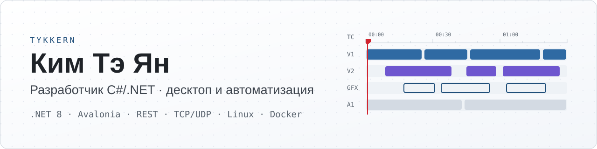

<picture>
  <source media="(prefers-color-scheme: dark)" srcset="assets/banner-dark.svg">
  
</picture>

Пишу настольные приложения на C#/.NET 8 и Avalonia: интеграции по REST API, сетевые протоколы, нагрузочное тестирование. За год выпустил пять утилит. Каждую довожу до релиза сам: код, тесты, сборка в один exe и руководство пользователя в PDF.

Кроме этого автоматизирую процессы в n8n, пишу Telegram-ботов и администрирую Linux-серверы (Docker, nginx, systemd).

## Стек

**Основное** &nbsp;

**Веб и боты** &nbsp;

**Данные и протоколы** &nbsp;

**Инфраструктура** &nbsp;

## Рабочие проекты

Код закрыт: он принадлежит компании и заказчикам.

| Проект | Что делает | Результат |
|---|---|---|
| AssetAutoLoader | Автозагрузка медиа в Carrot по REST API, докачка при обрыве связи | Время оператора на загрузку меньше примерно на 90%; 48-часовой прогон, около 720 ГБ |
| MOS Load Tester | Нагрузочный тест MOS-адаптера реальным эфирным трафиком | 6,4 часа эфира за полторы минуты, до 300 сообщений в секунду |
| EventCleaner | Очистка неиспользуемых событий через API | Ручная чистка ушла, это около 4 часов инженера в месяц |
| Carrot Logs Analyzer | График активности и поиск типовых ошибок в логах | Поиск причины сбоя занимает 10 минут вместо часа |
| Port Tester | Имитация множества устройств на одном TCP/UDP-порту | Проверка без стенда из реального оборудования |
| WbAlert | Оповещение об авариях с контроллеров Wiren Board, эскалация, Telegram, MAX и WhatsApp | Оповещение в течение минуты, до 500 объектов |
| Сценарии n8n | Заявка с почты сразу становится задачей в YouGile | Путь от заявки до готовой графики стал вдвое короче |

## Открытые проекты

| Репозиторий | Что внутри |
|---|---|
| [figma-plugin](https://github.com/Tykkern/figma-plugin) | Плагин Figma: HTML-страница превращается в слои с анимациями, hover и кликами |
| [ktor-kmp-api](https://github.com/Tykkern/ktor-kmp-api) | REST API на Ktor в структуре Kotlin Multiplatform |
| [taskmanager_spring](https://github.com/Tykkern/taskmanager_spring) | REST API на Spring Boot: WebFlux, R2DBC, корутины |
| [user-message-service](https://github.com/Tykkern/user-message-service) | HTTP-сервер на Kotlin поверх TCP-сокетов, без фреймворков |
| [warehouse-app_java_retake](https://github.com/Tykkern/warehouse-app_java_retake) | Учёт запчастей сервисного центра: DAO, JDBC, транзакции |
| [minishop](https://github.com/Tykkern/minishop) | Интернет-магазин на Jakarta Servlet, JSP и JSTL |

## Контакты

Telegram [@tykimm](https://t.me/tykimm) · почта [kimteyan107@gmail.com](mailto:kimteyan107@gmail.com)

<b>In English</b>

 

C#/.NET developer. I build desktop tools on .NET 8 and Avalonia for the Carrot broadcast graphics platform: REST API integrations, network protocols, load testing. Each tool ships as a single exe with a PDF user guide.

Two examples: a media auto-uploader that cut operator time by about 90%, and a MOS load tester that replays 6.4 hours of live broadcast traffic in 90 seconds at up to 300 messages per second.

I also automate workflows with n8n, write Telegram bots and run Linux servers (Docker, nginx, systemd).

Contact: Telegram [@tykimm](https://t.me/tykimm), [kimteyan107@gmail.com](mailto:kimteyan107@gmail.com)

